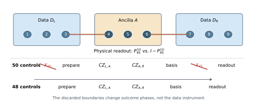

# Measurement-Aware Exchange-Only Compilation for Coherent Spin-Qubit Parity Readout

**APS / Physical Review X–style computational working manuscript — November 2026. Not submitted; authorship pending.**

## Abstract

In an exchange-only (EO) processor, a stabilizer check is commonly constructed from logical entangling gates even though initialization and measurement constrain the operations that must be implemented coherently. We formulate compilation directly at the level of the measured quantum instrument, preserving logical coherence and all gauge inputs while permitting physically irrelevant ancilla phases. For two data EO qubits and one ancilla, this distinction yields an exact reduction of a $ZZ$-parity extraction from 50 to 48 active exchange controls and from 29 to 27 nominal scheduling layers. A different physical ancilla-preparation branch, selected against independently sampled, shot-static per-bond exchange-gain errors, reduces the calculated wrong-syndrome curvature from $50.1050$ to $46.0078$. In 750 paired simulations with $1.5\%$ static bond-gain disorder and $0.06\%$ independent control jitter, the wrong-syndrome probability changes from $1.1036\%$ to $1.0045\%$. We independently verify the ideal instrument in the full nine-spin physical space and provide coherence-preserving, CZ-factorized $ZZZZ$ and $XXXX$ reference checks on an explicitly assumed 15-spin star topology. The result demonstrates an application-specific compilation principle and a model-dependent improvement; it does not establish repeated error correction, a threshold, or an experimentally calibrated noise advantage.

# Introduction

Exchange-only qubits encode one logical two-state degree of freedom in three interacting electron spins. Their operations require only electrically controlled exchange interactions, an attractive alternative to individually addressed magnetic or microwave rotations, but a universal logical gate may require a long positive-exchange sequence. Leakage out of the encoded total-spin manifold complicates both gates and readout \[1, 2\]. Recent semiconductor experiments have demonstrated parallel control of EO qubits and exchange-based silicon-processing primitives \[3, 4\]; simultaneous noncommuting exchange has also been studied explicitly for reducing gate complexity \[5\]. The appropriate circuit abstraction must therefore include the correlations, geometry, and leakage properties of physical exchange operations rather than treating them as arbitrary ideal qubit gates.

A stabilizer measurement has a less demanding terminal condition than a universal coherent gate. Once an ancilla is prepared in a known state and irreversibly measured, operations that differ only by an input-global phase or by an outcome-dependent phase are indistinguishable in the conditional state of the data. Standard compilation, in contrast, tends to enforce a particular unitary on every ancilla input state. This difference raises a precise question: *Can an exchange-only stabilizer measurement be shortened and made less sensitive to exchange-gain disorder by optimizing its quantum instrument rather than an intermediate gate?*

We answer this question constructively for two data EO qubits and one EO ancilla. The primary claim is a general, exact *boundary-elimination lemma* for preparation and projective readout; its implementation deletes two nontrivial exchange controls in a nine-spin parity extractor without approximating its data-state Kraus maps. A second, deliberately separate result is a gain-error-aware selection between physically distinct ancilla preparation paths, which reduces simulated syndrome errors without changing the ideal measurement. We retain both the broader six-spin CZ results and a five-EO four-body reference only to establish the baseline, physical boundary, and scaling limitations of this approach. The work is computational and is not a hardware demonstration.

# Physical encoding and instrument objective

## Spin-exchange controls and gauge-resolved validation

Let $P^{(s)}_{ij}=(\mathbb I-\mathrm{SWAP}_{ij})/2$ be the singlet projector for spins $i,j$. In the normalization used throughout this work, a positive exchange control has the physical action $$X_{ij}(a)=\exp(i\pi aP^{(s)}_{ij}),\qquad 0.15\leq a<2,$$ for every active control in the reported optimization domains. When adjacent bonds are pulsed simultaneously, their projectors do not generally commute. One layer must therefore be propagated as $$U_\ell=\exp\!\left(i\pi\sum_{b\in\mathcal B_\ell}a_{\ell b}P^{(s)}_b\right),\qquad U=U_L\cdots U_1,$$ not as an artificial product of sequential exponentials.

Each EO triple has an encoded total-spin-$1/2$ subspace with a logical and a gauge degree of freedom; its spin-$3/2$ manifold is leakage. The left data triple, ancilla triple, and right data triple occupy spins $(1,2,3)$, $(4,5,6)$, and $(7,8,9)$, respectively. For a six-spin encoded entangler, all 16 logical–gauge basis columns are tested in the full $2^6=64$ physical Hilbert space. For a three-EO measurement, the physical dimension is $2^9=512$; coherence and gauge independence are checked on the corresponding encoded inputs, not only on one selected gauge sector.

For an ancilla initialized in $|0,g_A\rangle$, let $\rho_D$ denote an arbitrary encoded data state (including its gauge). If $U$ is the full physical exchange sequence and $M_m$ is the physical ancilla projector for readout outcome $m$, the operational object is the completely positive instrument $$\begin{aligned}
\mathcal I_m(\rho_D)={}&\operatorname{Tr}_A\big[(M_m\otimes\mathbb I_D)U\, (|0,g_A\rangle\!\langle0,g_A|\otimes\rho_D)\nonumber\\
&\qquad\quad \times U^\dagger(M_m\otimes\mathbb I_D)\big].
\end{aligned}$$ The ideal nondemolition $ZZ$ check is the pair of maps $\mathcal I_m^{\rm ideal}(\rho)=P_m^{ZZ}\rho P_m^{ZZ}$ with $$P_m^{ZZ}=\frac{\mathbb I+(-1)^m Z_LZ_R}{2},\qquad m=0,1.$$ Correct syndrome probabilities alone do *not* establish Eq. (see equation): intra-sector coherence and leakage must also be controlled. We verify the outcome-resolved Kraus action, modulo phases that cancel from Eq. (see equation).

## A gain-error model with explicit correlations

A fractional over- or under-rotation $\delta_b$ is drawn once for each physical exchange bond $b$ in a shot and applied to *every* occurrence of that bond. A distinct random variable $\eta_{\ell b}$ affects each active control. Schematically, $$\begin{aligned}
 a_{\ell b}^{\rm noisy}&=a_{\ell b}(1+\delta_b+\eta_{\ell b}),\nonumber\\
 \delta_b&\sim\mathcal N(0,\sigma_s^2),\qquad
 \eta_{\ell b}\sim\mathcal N(0,\sigma_i^2).
\end{aligned}$$ We use the declared *model parameters* $\sigma_s=0.015$, $\sigma_i=0.0006$. They are not site-resolved measurements or a uniquely established decomposition of the HRL apparatus \[4\]. Context-dependent coactivation effects and time-dependent decoherence are not included in our primary Monte Carlo comparison.

For an observable error $p(\bm\delta)$ that vanishes at the ideal instrument, define its second-order per-bond coefficient $H_{p,b}$ by $p(\delta_b)=H_{p,b}\delta_b^2+O(\delta_b^3)$ with other gains set to zero; the total reported curvature is $H_p=\sum_b H_{p,b}$. Thus $$\mathbb E[p]\simeq\sigma_s^2\sum_b H_{p,b}+\sigma_i^2\sum_{\ell b}H_{p,\ell b}^{\rm iid},$$ up to higher-order terms. We separately track wrong-syndrome probability, instrument loss, and leakage. Their curvatures are *not* interchangeable with an isolated CZ gate infidelity or with a fault-tolerant logical error rate.

# Exact compilation at preparation and readout boundaries

## Instrument-equivalence lemma

Consider an ancilla-only control $L_{\rm in}$ applied *before* any data interaction and $L_{\rm out}$ applied immediately before the recorded projective measurement. Suppose $$\begin{align}
 L_{\rm in}|a_0\rangle &=e^{i\alpha}|a_0\rangle,\\
 M_mL_{\rm out}&=e^{i\beta_m}M_m
\end{align}$$ for the prepared ancilla state and for each measured outcome. Then deleting $L_{\rm in}$ and $L_{\rm out}$ leaves the data instrument (see equation) *exactly unchanged*. The proof follows by inserting Eq. (see equation) in the joint output amplitudes; the factors $e^{i(\alpha+\beta_m)}$ cancel against their conjugates in each conditional density operator. No equivalence of the intermediate unmeasured unitaries is required.

The result is particularly transparent for the EO ancilla. Let spins 4 and 5 be the singlet–triplet readout pair. Then $$M_0=P^{(s)}_{45},\qquad M_1=\mathbb I-P^{(s)}_{45},\qquad X_{45}(a)=e^{i\pi aP^{(s)}_{45}}.$$ The encoded ancilla $|0,g_A\rangle$ contains a singlet on $(4,5)$, so $X_{45}(a)|0,g_A\rangle=e^{i\pi a}|0,g_A\rangle$ for either gauge. At the output, $$M_0X_{45}(a)=e^{i\pi a}M_0,\qquad M_1X_{45}(a)=M_1.$$ The input and output exchange controls therefore satisfy the lemma. Importantly, Eq. (see equation) acts on the *physical projector*: the $m=1$ outcome also contains spin-$3/2$ leakage, so the argument does not silently assume a leakage-free triplet outcome.

## Two-pulse ancilla transformations

The standard ancilla Hadamard has three physical exchange controls. At the preparation boundary, however, only the map $|0\rangle\mapsto |+\rangle$ is specified, while at the final boundary only the appropriate measurement *basis* is specified. Deleting the redundant factors leaves two-control preparation and two-control readout, interleaved with two 22-control CZ entanglers. The result is an exact *48-control* circuit rather than 50 controls, with nominal nonconflicting-layer depth reduced from 29 to 27. The corresponding $XX$ check, obtained from physical EO basis transformations on the data, reduces from 62 to 60 controls.

On the full nine-spin implementation, outcome-phase-aligned encoded Kraus residuals for the optimized 48-control $ZZ$ construction are $1.58\times10^{-15}$ and $1.80\times10^{-15}$, and for the 60-control $XX$ reference they are $3.13\times10^{-15}$ and $2.13\times10^{-15}$, respectively. These are floating-point verification residuals, not measurements of experimental infidelity. The result does not imply that every three-pulse Hadamard can be shortened as an arbitrary logical gate: the preparation and readout promises are indispensable.

# Noise-aware state preparation and instrument performance

The two-control boundary operations admit distinct positive-exchange branches with the same ideal action under the input and measurement promises. We evaluated two preparation and two measurement branches, and also a finite screen of forward/reverse physically exact CZ decompositions. Although all four preparation/readout combinations implement the same ideal data instrument, they have different derivatives with respect to the shot-static physical bond gains. Table (see figure/table) presents the calculated coefficients for the full nine-spin measurement. The best candidate, denoted P1R0, changes the preparation branch while retaining the first readout branch.

| Sequence        |       C/D | $H_{\mathrm{inst}}$ | $H_{\mathrm{wrong}}$ | $H_{\mathrm{leak}}$ |
|:----------------|----------:|--------------------:|---------------------:|--------------------:|
| Conventional    |     50/29 |              90.175 |               50.105 |              36.321 |
| Pruned P0R0     |     48/27 |              90.175 |               50.105 |              36.321 |
| Pruned P0R1     |     48/27 |              87.589 |               47.519 |              36.321 |
| **Pruned P1R0** | **48/27** |          **86.078** |           **46.008** |              36.320 |
| Pruned P1R1     |     48/27 |              93.809 |               53.739 |              36.320 |

Nominal resource and quadratic shot-static-gain sensitivity of the physically modeled nine-spin $ZZ$ instrument. The differences between rows are conditional on the same ideal parity Kraus maps. $H$ values are defined in Eq. (see equation); smaller is better. The coefficients do not include a duration-induced dephasing model.

The change $H_{\mathrm{wrong}}:50.1050\rightarrow46.0078$ is an $8.18\%$ reduction in the leading shot-static wrong-syndrome coefficient. Its largest bond-specific contribution is associated with ancilla $J_{56}$: the wrong-syndrome curvature on this bond changes from approximately 20.0460 to 14.2895. This is useful in judging which physical resources to optimize: the most consequential bond for a complete stabilizer instrument need not be the inter-EO bridge that dominates a particular isolated entangler’s error model.

To go beyond the second-order curvature analysis, we compared the two sequences under 750 *paired* stochastic draws. Each pair shares the same shot-static bond gains and uses the same declared independent control-jitter distribution. At $\sigma_s=1.5\%$ and $\sigma_i=0.06\%$, wrong-syndrome probabilities averaged $1.103592\%$ for the 50-control reference and $1.004484\%$ for the 48-control P1R0 circuit. The difference is $-0.09911$ percentage points, with an estimated 95% paired confidence-interval half-width of $0.02694$ percentage points. Instrument loss changes from $1.9741\%$ to $1.8740\%$, while the corresponding leakage change is not statistically resolved in this sample. These are simulated averages for the model in Eq. (see equation).

## Why a gate-centric optimum need not minimize the check error

To assess the cost of using lower-static-error entanglers, we also assembled parity checks from two 30-control, simultaneous-exchange CZ gates (66 total controls including ancilla operations). These exact CZs were obtained by gauge-aware six-spin optimization of positive exchange and reached a per-bond quadratic harmful coefficient $H_{\mathrm{pb}}=32.0119$, as compared with $37.6681$ for the relevant 28-control reference. Such six-spin coefficients include logical and leakage tangent components; they are not directly equal to $H_{\mathrm{wrong}}$ of the composite nine-spin instrument. In the parity check, the 66-control construction has greater nominal depth (39 compared with 27) and does not provide a statistically resolved wrong-syndrome advantage over P1R0 under the reported 750-draw matched simulation. It does improve some other instrument metrics. This is a concrete example of a *resource-conditioned Pareto trade-off*, rather than an assertion that shorter is always better or that gate fidelity ceases to matter.

# Coherent four-body reference and the architecture boundary

A weight-four stabilizer check must measure $P_m^S=(\mathbb I+(-1)^m S)/2$ without learning an additional commuting check. For example, measuring $Z_1Z_2$ and $Z_3Z_4$ separately and multiplying the recorded signs is *not* the same instrument as measuring only $Z_1Z_2Z_3Z_4$: the former generally destroys coherence between the two fine-grained parity sectors sharing the same product. Applied to $|++++\rangle$, the pure postselected $ZZZZ=+1$ state from the ideal four-body projection is replaced by a mixed state of purity $1/2$ if two separate two-body projectors are measured and their outcomes are coarse-grained.

As a full-physics reference, we constructed one EO ancilla plus four data EO triples, i.e., 15 physical spins. The physical graph is *not* a nearest-neighbor line: a designated ancilla spin is assumed to have four individually controllable exchange connections to the data triples. Four complete 22-control CZ gates combined with the 4-control ancilla preparation/readout yield a 92-control $ZZZZ$ instrument; physically implemented data EO basis conjugations give a 116-control $XXXX$ instrument. Their nominal ASAP depth proxy is 56 layers under identical-layer durations and nonoverlapping scheduling.

The 15-spin verification propagates the actual $2^{15}=32768$-component spin state and checks all 16 data logical basis strings times 32 logical–gauge configurations, for 512 encoded inputs. The largest residuals for the specified ideal coherent outcomes are approximately $2.45\times10^{-15}$ ($ZZZZ$) and $3.31\times10^{-15}$ ($XXXX$); superposition tests verify intra-syndrome coherence. These checks are an *upper-bound construction on a hypothetical geometry*, not a native non-CZ four-body pulse, a realistic linear-routing cost, or a stochastic 15-spin fault-tolerance assessment.

# Discussion and outlook

The main observation is conceptual but operational: *compilation targets should encode the entire physical task*. For exchange-only stabilizer measurements, it is too restrictive to demand an arbitrary-state ancilla Hadamard at a boundary where only a state preparation or a projective readout is performed. The resulting exact phase-equivalence argument is independent of the assumed gain-noise distribution. Noise-aware choice among the remaining physically admissible preparations then reduces a specific, experimentally relevant type of model error—the wrong-syndrome probability under shot-static exchange-gain disorder—without claiming full gain insensitivity.

Several distinctions prevent overinterpreting this result. First, the observed advantage is moderate; the 48-control check is still built from two full CZ gates and is not a newly discovered nonfactorized native parity primitive. Second, the quadratic gain coefficients and Monte Carlo are *not* calibrated device rates. Independent pulse jitter, waveform transients, context dependence, leakage readout ambiguity, ancilla reset, idling and repeated-cycle error propagation can alter the ranking. Third, the 15-spin star couplers are assumptions rather than demonstrated connectivity. Fourth, suppression of wrong-syndrome errors in one round does not imply a smaller decoded logical error rate after many rounds. These limitations are material to any claim of device scalability or quantum-error-correction advantage.

A decisive next step would be a *direct* instrument synthesis that drops the decomposition into two CZ gates, optimizes all outcome-conditioned Kraus actions on the full logical–gauge domain, and tests the resulting pulse schedules under a measured covariance matrix including temporal correlations and pulse duration. Repeated check cycles with an explicit leakage-reduction and reset protocol, plus decoder benchmarking against the factorized baseline, would be required to elevate a compilation improvement into a system-level error-correction claim. Under that standard, the present study supplies a reproducible measurement-level benchmark and a rigorous boundary simplification, not evidence of fault tolerance.

# Data availability and reproducibility

The manuscript source, exact sequence files and an evidence ledger are organized under the public repository <https://github.com/GitGuanjie/EO>, in `research/eo-qec-2026`. The frozen source archive for the nine- and 15-spin validation, including the physical exchange model, pulse CSVs, and stochastic evidence, accompanies this working draft. Reproduction requires the frozen archive in addition to the manuscript files. Authors should provide a permanent archive DOI and its full citation before journal submission.

# Acknowledgments and disclosures

Author list, institutional affiliations, funding acknowledgments, and contribution statements must be verified before submission. This draft was prepared with AI-assisted writing and code organization from existing computational research materials; authors must independently verify all derivations, simulations, sources, attribution, and the applicable APS AI-use disclosure requirements. No experimental measurements were performed for this manuscript.

## References

[1] B. H. Fong and S. M. Wandzura, “Universal quantum computation and leakage reduction in the 3-qubit decoherence free subsystem,” *Quantum Information & Computation* **11**, 1003–1018 (2011). https://doi.org/10.26421/QIC11.11-12-9

[2] G. T. Hickman, X. Wang, J. P. Kestner, and S. Das Sarma, “Dynamically corrected gates for an exchange-only qubit,” *Phys. Rev. B* **88**, 161303(R) (2013). https://doi.org/10.1103/PhysRevB.88.161303

[3] M. T. Mądzik et al., “Operating two exchange-only qubits in parallel,” *Nature* **647**, 870–875 (2025). https://doi.org/10.1038/s41586-025-09767-5

[4] Members of the HRL Quantum Team and Collaborators, “A digitally controlled silicon quantum processing unit,” *Nature* **655**, 1154–1159 (2026). https://doi.org/10.1038/s41586-026-10754-7

[5] I. Heinz et al., “Fast Quantum Gates for Exchange-Only Qubits Using Simultaneous Exchange Pulses,” *PRX Quantum* **6**, 030353 (2025). https://doi.org/10.1103/njq3-fcdd